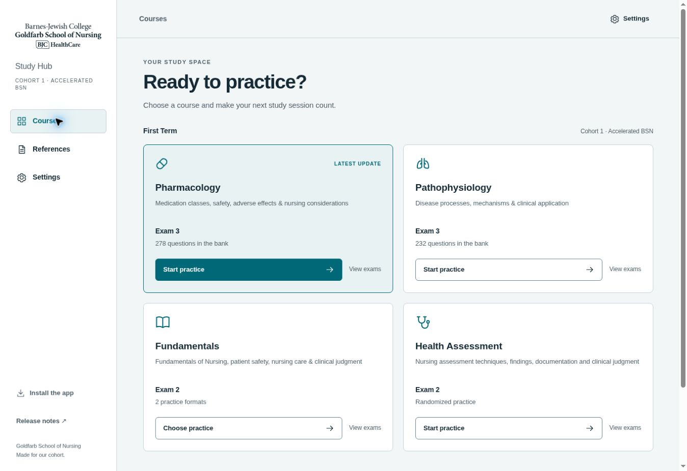

# Modern Workspace — development design

October 30, 2026. The owner selected the Modern Workspace column of the supplied theme board and requested two light and three dark palettes. This supersedes the original purple/gradient/emoji design and five-choice System/Light/Dark/Purple/Slate contract. Implementation is staged on `pwa-redesign` for the existing Render test site. Main remains unchanged until the owner approves the design.

## Layout and navigation

A fixed desktop sidebar contains Courses, References, and Settings. The main area has a compact context bar and a two-column course grid; there is no large hero. Below 760px, navigation becomes a sticky top row, and below 480px course tiles become a single column. SVG line icons are decorative and hidden from accessibility names. A keyboard skip link targets the main content.

Course tiles sort by the newest exam `updatedAt`, using the same recency semantics as the previous release. Latest-course highlighting reflects those timestamps, not student progress. A one-format latest exam gets a direct Start practice action; multi-format exams open the course chooser. View exams remains available for older exams. Course pages open the most recently updated exam group and leave older groups closed.

Counts displayed as bank sizes come only from an explicit N-question bank label. Other formats show a format count or randomized-practice label; no personal progress, scores, or streaks are invented.

## Five shared themes

| ID | Label | Mode |
|---|---|---|
| teal | Slate + Teal | Light |
| ivory | Ivory + Burgundy | Light |
| charcoal | Charcoal + Amber | Dark |
| midnight | Midnight + Blue | Dark |
| aubergine | Aubergine + Lavender | Dark |

`themes.js` is the early shared appearance loader; `workspace.css` defines common tokens and layout. Theme choices are buttons with explicit labels and aria-pressed state. The first-visit default is teal. The existing local `gson-study-hub-theme` key is retained. Old Light maps to teal, Dark to charcoal, Purple to aubergine, and Slate to midnight. Old System resolves from the OS to teal or charcoal. Invalid values or unavailable storage fall back to teal. Existing legacy values are interpreted on read; choosing a new palette persists its new ID. Storage events update other open hub/exam tabs. There is no visible System option in this new five-palette design.

Theme application covers `index.html`, `exam.html`, and `exam3-preview.html`. Standalone older HTML exam versions have embedded styles and are not silently rewritten. Optional answer-choice palettes remain a separate preference; neutral answer styling and selected state never imply correctness before Submit.

## Contracts preserved

Question-bank content, correct keys, selection quotas, topic/subtopic controls, count bounds, question/option shuffling, forward-only progression, exact-set SATA/matching scoring, post-submit feedback, scoring gate, and review behavior are unchanged. Original-source links and the reference viewer remain intact. Settings retains answer colors and notifications. Installation help is available in the desktop sidebar and in Settings on narrow screens; browser permission is requested only by the existing explicit notification action.

The preview uses current production content as its baseline, avoiding the older Pathophysiology bank previously present on development. The existing Render backend and production hosting configuration are not changed.

## Cache and verification

Static-shell cache `gson-shell-v4-workspace` includes the versioned new shell assets. Navigation remains network-first with offline shell fallback. Question banks and PDFs remain excluded. Installing a new worker does not reload an active exam or migrate its in-memory answers; an existing open page may need a reload after finishing the attempt.

Automated checks cover JavaScript syntax, DOM ID uniqueness, all five selections, persistence and legacy migration, blocked-storage fallback, and pressed-state exclusivity. Text/accent/success/error tokens and primary-button text were checked against all three defined surfaces; minimum tested ratios are teal 5.48, ivory 5.22, charcoal 6.29, midnight 6.72, aubergine 6.41. This is limited token verification, not a full accessibility certification.

`dev/workspace-layout-check.html` embeds the real hub at 320, 390, and 768 CSS pixels for browser layout checks. It is a development aid, not a student navigation entry. Browser checks must include five palette switches, persistence, hub/course/reference navigation, latest/closed exam states, mobile overflow, installation help, and shared-exam setup/submission without changes to feedback timing. Record observed results separately from planned checks.

## Observed Render checks

The staged site rendered the sidebar, course grid, and 278/232-question production bank labels. All five palette buttons changed the actual root palette/mode and selected state; Charcoal + Amber remained selected after reload and applied on entering the exam page. Pharmacology Exam 3 was open and Exam 2 closed. A two-category custom selection displayed 93 eligible questions; a one-question attempt preserved explicit Submit, no correctness before submission, locked answers, feedback/source links, final Score, and read-only review. The full References menu retained its original-source links and download controls. Large narrated-file downloading was not repeated for this style change.

A fixed-width browser harness checked nominal 320, 390, and 768px frames (content widths are smaller when a browser scrollbar is present). A 2px navigation overflow at the narrowest width was identified and corrected by reducing navigation spacing. Mobile also omits the duplicate context toolbar. After the final CSS deploy, all three frames had scrollWidth equal to clientWidth (305, 375, and 753px respectively); the 320px Settings view also had no overflow and displayed all five themes. The 390px shared-exam setup had no overflow, inherited Charcoal + Amber, and used the matching browser theme-color. Installation help opened correctly from narrow-screen Settings. These are browser frame tests, not physical iPhone device certification. No notification permission request was initiated.

## Implemented preview

Captured from the Render development deployment. The screenshot shows actual implemented UI, not the earlier generated concept. Main remains unchanged.

## School branding

The original `assets/BJC_GSON_Small.svg` remains unchanged. The app uses a theme-aware derivative, `assets/BJC_GSON_Theme.svg`, inlined in the sidebar/mobile header so `currentColor` can inherit the theme text color. The original viewBox, vector paths, and transforms are preserved; editor metadata is omitted. There is no background plate. Light palettes use their dark ink and dark palettes use their off-white ink. The cached HTML contains the inline vector.

The restored logo loaded successfully on desktop and in nominal 320/390px frames. The mobile SVG displayed at 138px wide; both narrow documents retained scrollWidth equal to clientWidth. The implemented-preview image includes the restored branding.

October 30 refinement: replaced the fixed white logo/brand plate with the transparent, currentColor vector after owner feedback. Path geometry and transforms were checked against the original; theme switching needs no image fetch.

Render verification: all five palettes produced logo fill equal to their text ink, with a fully transparent wrapper. The original asset geometry remains unchanged. Updated preview shows dark logo ink in Slate + Teal.

Resource cleanup: removed the Question Bank Review panel and reviewer link from the reference-library screen at owner request. Course source links remain. The underlying reviewer files and audit data are preserved.
